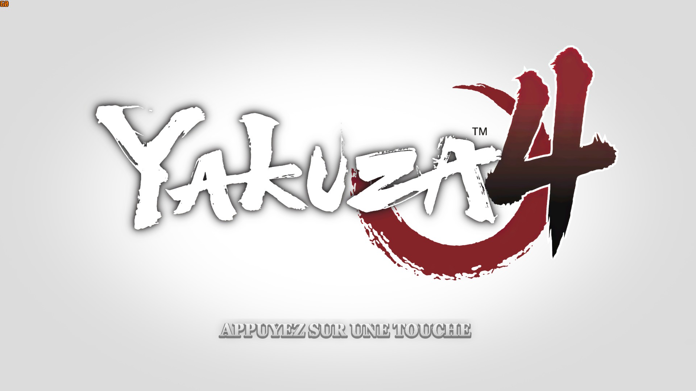
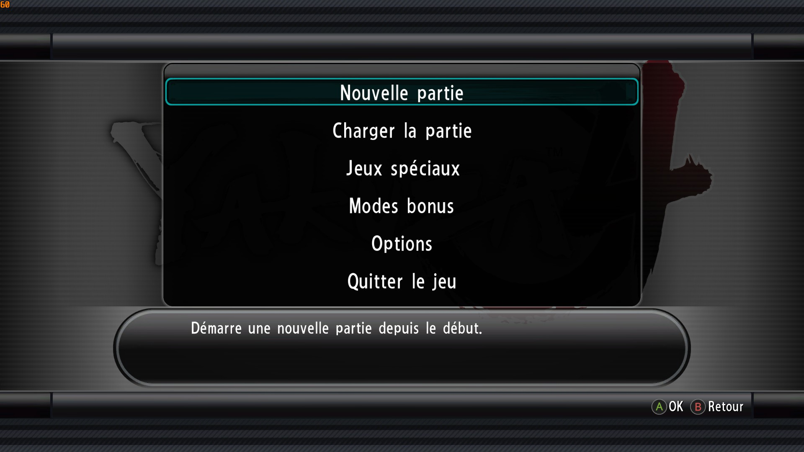
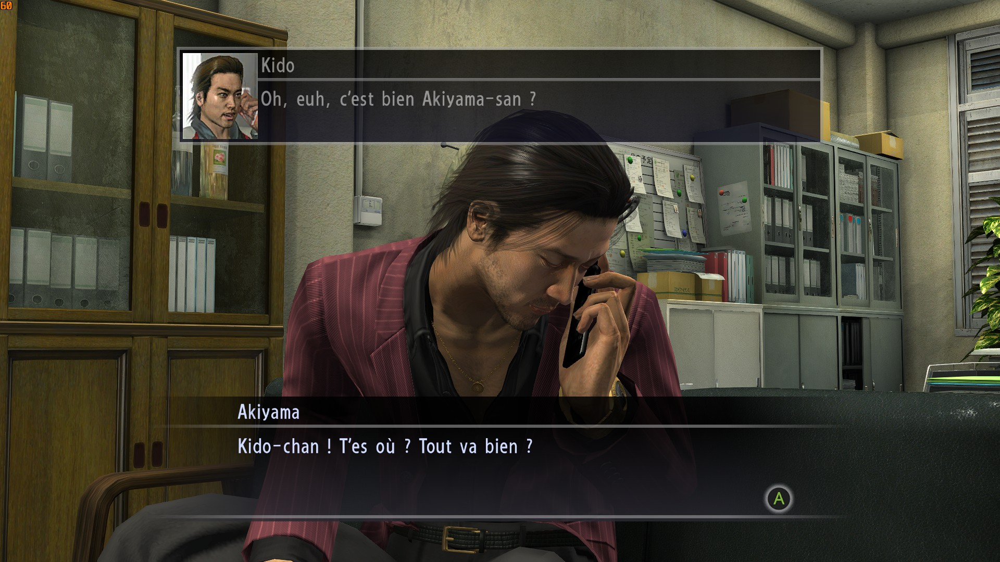
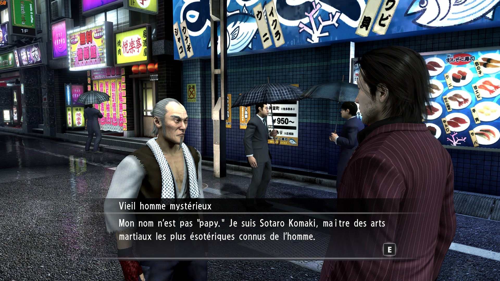
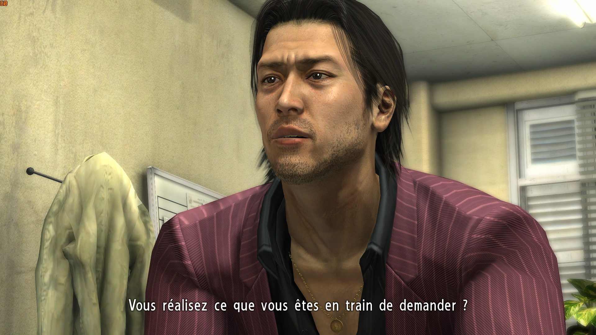
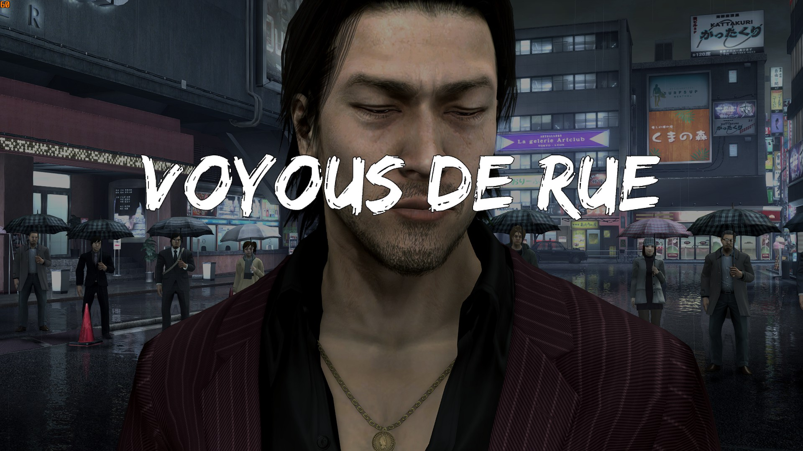
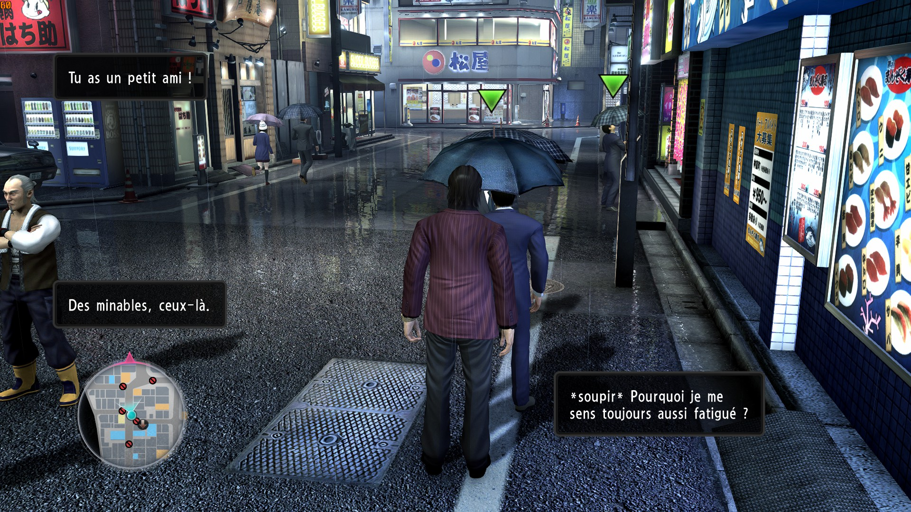

  

  
  
  

# Yakuza 4 Remastered — Traduction française (mod PC Steam)

> Mod de traduction française non officiel pour *Yakuza 4 Remastered* sur PC
> Steam : dialogues, sous-titres, menus, objectifs et interface en français.

**[Télécharger la dernière version](https://github.com/Egld-Rma/Yakuza4-Remastered-FR/releases/latest)**

## Sommaire

- [Le projet](#le-projet)
- [Aperçus](#aperçus)
- [Installation](#installation)
- [Contenu du patch](#contenu-du-patch)
- [État du projet](#état-du-projet)
- [Communauté](#communauté)
- [Signaler un problème](#signaler-un-problème)
- [FAQ](#faq)
- [Roadmap](#roadmap)
- [Remerciements](#remerciements)

## Le projet

Ce projet propose une traduction française de *Yakuza 4 Remastered*. Il est
réalisé par **Egld** pour rendre cette partie de la série plus accessible
aux joueurs ayant découvert la licence avec *Yakuza Kiwami*, *Yakuza Kiwami 2*
et *Yakuza Kiwami 3 & Dark Ties*.

La traduction couvre les dialogues, sous-titres, menus, objectifs,
descriptions, messages d'ambiance et plusieurs éléments graphiques. Le travail
sur *Yakuza 4* servira aussi de base aux projets prévus sur *Yakuza 3*

## Aperçus

  
  

  
  

  
  

## Installation

Deux versions sont proposées dans la
[dernière release](https://github.com/Egld-Rma/Yakuza4-Remastered-FR/releases/latest) :

- `Yakuza4-Remastered-FR-v3.0.rar` pour l'installation manuelle ;
- `Yakuza4-Remastered-FR-SRMM-v3.0.zip` pour Shin Ryu Mod Manager.

Choisis une seule méthode d'installation. N'installe pas les deux versions en
même temps.

### Installation manuelle

1. Dans Steam, règle la langue de *Yakuza 4 Remastered* sur **English**.

2. Télécharge `Yakuza4-Remastered-FR-v3.0.rar` depuis la dernière release.

3. Ferme *Yakuza 4 Remastered*.

4. Décompresse l'archive.

5. Glisse le dossier `data` dans le dossier d'installation du jeu.

6. Accepte le remplacement des fichiers.

Il n'y a aucun installateur à lancer. Pour revenir à la version d'origine,
utilise la vérification de l'intégrité des fichiers dans Steam.

### Installation avec Shin Ryu Mod Manager

1. Dans Steam, règle la langue de *Yakuza 4 Remastered* sur **English**.

2. Si une ancienne version du patch a été installée manuellement, restaure
   d'abord les fichiers d'origine avec la vérification de l'intégrité des
   fichiers dans Steam.

3. Installe **Shin Ryu Mod Manager** dans le dossier principal du jeu, à côté
   de `Yakuza4.exe`.

4. Télécharge `Yakuza4-Remastered-FR-SRMM-v3.0.zip` depuis la dernière release.

5. Importe le ZIP directement avec la fonction d'installation de mod de Shin
   Ryu Mod Manager.

6. Active `Yakuza4-Remastered-FR-v3.0`, puis applique la liste des mods.

7. Lance le jeu.

Le ZIP SRMM ne doit pas être extrait manuellement dans le dossier `data`. Pour
désinstaller cette version, désactive ou supprime le mod dans Shin Ryu Mod
Manager, puis applique de nouveau la liste des mods.

> Télécharge l'archive depuis **Releases**. Le bouton
> **Code → Download ZIP** ne contient pas le patch installable.

### Compatibilité

La traduction est construite et testée sur Steam. La version dédiée à Shin Ryu
Mod Manager a été validée avec SRMM 5.0.4. Les versions GOG et Xbox app / Game
Pass pourraient être compatibles si leur dossier `data` est identique, mais
elles ne sont pas encore testées officiellement.

## Contenu du patch

Le dossier `data` de la release contient uniquement les fichiers modifiés :

- **Interface et écrans** — `data/2d/`, `data/fontpar/` et `data/mvuen/`
- **Cinématiques et séquences** — `data/auth/` et `data/hact/`
- **Menus, objectifs et descriptions** — `data/bootpar/`, `data/pausepar/`,
  `data/ikusei/` et `data/db.soul/`
- **Courriers et mini-jeux** — `data/scenario_en/` et `data/minigame/`
- **Dialogues, boutiques et interactions** — `data/wdr_par_en/`
- **Effets nécessaires à l'interface traduite** — `data/effect.par`

Liste technique complète des fichiers inclus

- `data/2d/cse_en.par`
- `data/2d/first_load_picture_en.par`
- `data/2d/sprite_en.par`
- `data/2d/tex_common_en.par`
- `data/auth/subtitle.par`
- `data/bootpar/boot_en.par`
- `data/db.soul/en/middle_file_reactive_obj_name.bin`
- `data/db.soul/en/msg.bin`
- `data/db.soul/en/msg_replacer.bin`
- `data/effect.par`
- `data/fontpar/font_hd_en.par`
- `data/hact/subtitle.par`
- `data/ikusei/ikusei_param_en.par`
- `data/minigame/chohan/bakuto_en.bin`
- `data/mvuen/CI_us.usm`
- `data/pausepar/pause_en.par`
- `data/scenario_en/mail.bin`
- `data/wdr_par_en/common.par`
- `data/wdr_par_en/wdr.par`

## État du projet

**Le patch est désormais disponible en version stable v3.0.** L'histoire
principale et l'intégralité des sous-intrigues ont été vérifiées manuellement.

Les cinq parties du jeu — Akiyama, Saejima, Tanimura, Kiryu et la partie finale
— sont **jouables et compréhensibles en français**, aussi bien pour l'histoire
principale que pour les sous-intrigues.

La v3.0 peut être installée manuellement ou utilisée avec **Shin Ryu Mod
Manager**. Le projet continuera de recevoir les corrections signalées par les
joueurs.

Des erreurs de contexte, d'affichage, d'orthographe ou de formulation peuvent
encore subsister. Les retours de jeu permettent de les repérer et de les
corriger.

## Communauté

Un serveur Discord regroupe le suivi du projet, les retours de bugs et les
bêta-testeurs : **[rejoindre le serveur](https://discord.gg/zYVqTqTnfZ)**.

Vous y trouverez le suivi de l'avancement, un salon dédié au signalement des
erreurs et toutes les informations concernant les prochaines versions.

## Signaler un problème

Ouvre une [issue GitHub](https://github.com/Egld-Rma/Yakuza4-Remastered-FR/issues),
passe par le salon dédié du [Discord](https://discord.gg/zYVqTqTnfZ), ou
contacte-moi directement : **egld**.

Pour qu'un signalement soit exploitable, indique :

- le chapitre ou l'endroit concerné ;
- ce qui s'affiche ou ce qui se produit ;
- une capture d'écran ou une vidéo si possible ;
- une sauvegarde si le problème dépend d'un chargement précis.

Les conseils, corrections de traduction et suggestions sont aussi les
bienvenus.

## FAQ

### Mes sauvegardes sont-elles compatibles ?

Le patch ne modifie pas les fichiers de sauvegarde.

### Comment désinstaller le patch ?

Pour la version manuelle, utilise la vérification de l'intégrité des fichiers du
jeu dans Steam. Pour la version SRMM, désactive ou supprime le mod dans le
gestionnaire, puis applique de nouveau la liste des mods.

### Quelle archive dois-je télécharger ?

Télécharge le RAR si tu veux installer le patch manuellement. Télécharge le ZIP
SRMM si tu utilises Shin Ryu Mod Manager. N'installe pas les deux versions en
même temps.

### Un texte est encore en anglais ou ne correspond pas à la scène.

Signale-le avec une capture et l'endroit exact. Les dialogues sont souvent
extraits hors contexte, ce qui peut mener à une mauvaise interprétation.

### Le patch fonctionne-t-il sur GOG ou Game Pass ?

La compatibilité est possible, mais non confirmée. Steam reste la plateforme de
référence pour les tests.

### Puis-je faire le jeu en entier avec cette version ?

Oui. L'histoire principale et les sous-intrigues ont été vérifiées
manuellement. Les cinq parties sont jouables et compréhensibles en français.

## Roadmap

- [x] Traduire l'histoire principale
- [x] Corriger les blocages signalés pendant la pré-bêta
- [x] Vérifier l'histoire principale de bout en bout
- [x] Vérifier l'intégralité des sous-intrigues
- [x] Continuer à corriger les formulations et erreurs signalées
- [x] Préparer la version stable v3.0
- [x] Ajouter une version compatible avec Shin Ryu Mod Manager
- [ ] Publier également le patch sur Nexus Mods

## Remerciements

- Les **bêta-testeurs** du projet, dont les retours ont permis de vérifier
  l'histoire principale et les sous-intrigues, ainsi que de corriger de nombreux
  problèmes impossibles à repérer sans jouer.
- [Byce61](https://www.youtube.com/@Byce61), dont le
  [let's play de *Yakuza 4 Remastered*](https://www.youtube.com/watch?v=wrGzgohh6nE&list=PLqIbGHNnXL8OAqlWcjmTunNXjs9ktXQIJ)
  a servi de référence pour le travail manuel sur les cinématiques.
- Les auteurs de la
  [traduction espagnole de *Yakuza 4 Remastered*](https://steamcommunity.com/sharedfiles/filedetails/?id=3620446326&l=spanish)
  et de [Yakuza 4 Patch ITA](https://github.com/zSavT/Yakuza4-Patch-ITA),
  pour les références techniques rendues publiques.
- Les projets open source
  [Lib20070319](https://github.com/Ret-HZ/Lib20070319) et
  [ParManager](https://github.com/Kaplas80/ParManager), utilisés pour mieux
  comprendre les archives du jeu.
